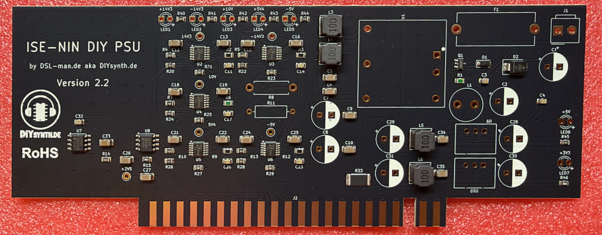
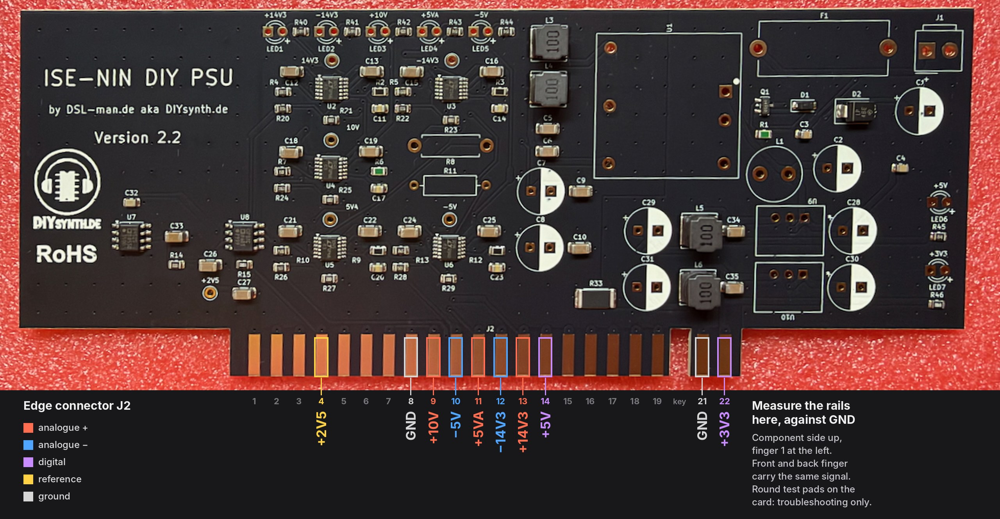

# Assembly guide — ISE-NIN DIY PSU, version 2.2

The card arrives with every SMD part already fitted by the board house, on
both sides. What is left for you is the through-hole parts. This guide takes you through them, then through
a first power-up outside the instrument, then into the instrument.

*Version 2.2 as it arrives. The silkscreen reads "Version 2.2" under the title.*

**If anything is unclear, ask me before you solder — not afterwards.**
Contact details are on the
[project page in the DIYsynth wiki](https://diysynth.wiki.dsl-man.de/wiki/spaces/ISENIN/pages/1244364806/ISE-NIN+DIY+PSU+card+upgrade).
A question costs a few minutes; a lifted pad or a wrong part can cost the card.

---

## Before you start

### Use only the parts in the BOM

Fit **only the parts listed in [`bom/mouser-bom.csv`](bom/mouser-bom.csv)** —
nothing else, no "equivalent" and no part from the drawer, unless we have
agreed on it first. Several positions look interchangeable and are not:

* **C7, C8, C28–C31 are standard-ESR electrolytics on purpose.** The
  capacitor's ESR damps the output filter. A low-ESR part makes it ring.
* **R8 and R11 are 1 W parts** and carry real power. A ¼ W resistor of the
  same value will run hot.
* **The two Recom regulators are different voltages** (5 V and 3.3 V) and look
  almost the same.
* **The LEDs run at 2 mA.** A standard LED will be very dim.

**C38 and R34 on the back stay empty.** The silkscreen there says "OPTIONAL
PART — FIT IF NEEDED". It is not needed on a normal build, and the two parts
are not in the BOM. Do not fit them without asking.

### ESD — static discharge

The regulators, the voltage reference and the op-amp on this card are
sensitive to static discharge. A discharge you do not even feel can damage
them, and the damage often shows up later as drift or noise rather than as an
outright failure. So:

* **Keep the card in its antistatic bag** until you are ready to work on it,
  and put it back into the bag whenever you stop.
* **Ground yourself.** Best is a wrist strap with its built-in 1 MΩ resistor,
  clipped to an ESD mat or to a grounded point. Without a strap, touch a
  grounded metal object right before you pick the card up, and again every
  time you have stood up or walked around.
* **Work on an ESD mat, or at least on a bare wooden table.** Not on carpet,
  plastic foil, foam or a cloth.
* **Use a soldering station with a grounded tip.** A plain plastic desoldering
  pump charges up when it fires; use desoldering braid or an antistatic pump.
* **No wool or synthetic clothing at the bench.** Cotton is fine.
* **Hold the card by its edges.** Do not touch the ICs, and do not touch the
  gold edge fingers at the bottom: skin grease on the contacts ends up in the
  backplane connector.
* **The same applies inside the instrument.** Before you pull the old card or
  insert the new one, touch the metal chassis of the ISE-NIN to bring yourself
  to the same potential.

### What you need

* Soldering station with a grounded tip, a medium chisel tip, solder
* Flush cutters
* Isopropyl alcohol, 99 % or better, and a soft brush (an old toothbrush
  works)
* Multimeter
* A bench power supply with a current limit — or the 12 V cable of the
  ISE-NIN itself, see [Step 10](#step-10--first-power-up-outside-the-instrument)

---

## Soldering order

Lowest parts first, tallest last — that way each part lies flat on the bench
while you solder it, and nothing is in the way of the soldering iron.
Push every part fully down onto the board before you solder it, solder one
leg, check that it still sits flat, then solder the rest and trim the legs.

### Step 1 — R8 and R11, the two power resistors

| Position | Value | Part |
|---|---|---|
| **R8** | 39 Ω, 1 W | KOA MOS1CT528R390J |
| **R11** | 68 Ω, 1 W | Vishay WK202070C6809F2200 |

They sit one above the other in the middle of the card. **Do not swap them.**
Measure each with the multimeter before you fit it. No polarity.

### Step 2 — the electrolytic capacitors

| Position | Value | Part |
|---|---|---|
| C1, C2 | 220 µF / 25 V | Panasonic EEU-FM1E221 |
| C7, C8, C28, C29, C30, C31 | 100 µF / 25 V | Nichicon UBW1E101MPD |

**Polarity matters.** The long leg is plus and goes into the hole next to the
`+` on the silkscreen. The stripe on the capacitor body marks minus and faces
the **white half** of the printed circle. Check every one before you solder
it — a reversed electrolytic fails loudly once power is applied.

### Step 3 — the two small regulators, U9 and U10

| Position | Output | Part |
|---|---|---|
| **U9** (upper) | 5 V | Recom R-78E5.0-1.0 |
| **U10** (lower) | 3.3 V | Recom R-78E3.3-1.0 |

They sit on the right, next to the `+5V` and `+3V3` LEDs. **Read the print on
the module before fitting** — the two look almost identical.
Pin 1 (+Vin) goes into the square pad. The pins are not centred in the module,
so the body has to sit over the printed rectangle; if it does, the orientation
is right.

### Step 4 — the fuse holder, F1

Littelfuse 0PTF0078P, top right. No polarity. It must sit flat on the board.
The fuse itself (2 A slow-blow, 5 × 20 mm, Littelfuse 0218002.MXP) goes in
after soldering, then the cover (00BS0232P) clicks on top.
Use only that fuse — not a faster one and not a larger one.

### Step 5 — the power connector, J1

MTA-156, 2-pin (TE 640445-2), top right corner. The square pad marked `+` is
+12 V, the other one is ground. **Before soldering, check the orientation
against the 12 V cable plug of your ISE-NIN** and against the connector on your
original card — the plug must latch, and plus must land on the `+` pin.

### Step 6 — the input inductor, L1

10 µH, Bourns RLB0913-100K, the round footprint left of C2. No polarity.
Seat it flat.

### Step 7 — the seven LEDs

Kingbright WP710A10LID, red, 3 mm. **The long leg goes into the hole next to
the `+` sign.** On this card that is the right-hand hole for all seven.

| LED | Rail |
|---|---|
| LED1 | +14.3 V |
| LED2 | −14.3 V |
| LED3 | +10 V |
| LED4 | +5 VA |
| LED5 | −5 V |
| LED6 | +5 V |
| LED7 | +3.3 V |

Solder one leg of each LED first, set them to the same height, then solder the
second leg.

### Step 8 — the DC/DC converter, U1

Traco THN 30-2423WIR, the big square module. It goes in last because it is
the tallest part. Its six pins are placed asymmetrically, so it only fits one
way. Seat it flat before soldering.

**New, or taken from your original card?** The module on the original MK1.0
card is the same type and can be reused. Desoldering it carries two real
risks:

* **The old card.** Six pins in plated-through holes, joined to wide copper
  areas. Pulling them with too little heat or too much force tears pads and
  through-hole plating out of the old card. After that it no longer works as
  a spare.
* **The module.** Traco's datasheet allows **260 °C for 6 s max.** (wave
  soldering). Desoldering a pin that sits on a large copper area easily takes
  longer than that, and heat that goes into the module can damage it inside,
  without any sign on the outside.

If you have a desoldering station with a vacuum gun, it is doable — one pin at
a time, with pauses for the module to cool. If you only have braid and a pump,
**buy a new module** (Mouser 495-THN30-2423WIR). In doubt, ask me first.

---

## Step 9 — cleaning and inspection

**Remove the flux residue.** Brush the solder joints with isopropyl alcohol and
the soft brush, a little at a time, and dab it off with a lint-free cloth.
Clean locally — do not flood the board and do not put it in an ultrasonic
bath. Keep flux and alcohol off the gold edge fingers; if they did get dirty,
wipe them clean with alcohol. **Let everything dry completely** before you
power up — under the larger parts that takes longer than on the surface.

**Then inspect** with a magnifier or the phone camera:

* every joint shiny and fully wetted, no solder bridges
* electrolytics: stripe on the white half
* LEDs: long leg on `+`
* U9 = 5 V, U10 = 3.3 V
* R8 = 39 Ω, R11 = 68 Ω
* C38 and R34 on the back: empty

**And measure, still without power:** with the multimeter in the resistance
range, between the two pins of J1, and between each rail finger and a ground
finger (table below). None of them may read as a short.

---

## Step 10 — first power-up, outside the instrument

**Measure at the edge fingers — not at the round test pads.**

### Where to measure

Look at the component side with the gold fingers at the bottom. **Finger 1 is
at the left end**, counting to the right. The gap in the fingers is position
20; to the right of it are fingers 21 and 22. Front and back finger carry the
same signal.

Measure every rail against **finger 8 or finger 21 (ground)**:

| Finger | Rail | Nominal | Allowed |
|---:|---|---:|---|
| 13 | +14.3 V | 14.30 V | ± 0.2 V |
| 12 | −14.3 V | −14.30 V | ± 0.2 V |
| 9 | +10 V | 10.00 V | ± 0.15 V |
| 11 | +5 VA | 4.99 V | **5.25 V max.** |
| 10 | −5 V | −4.99 V | ± 0.07 V |
| 4 | +2.5 V | 2.500 V | ± 0.005 V |
| 14 | +5 V | 5.00 V | ± 0.15 V |
| 22 | +3.3 V | 3.30 V | ± 0.10 V |

**+5 VA must never exceed 5.25 V** — that is the absolute maximum rating of
the oscillator chips it feeds. **+2.5 V** is the reference for all sixteen
oscillator chips, so read it with the best meter you have.

### The round test pads are for troubleshooting only

The six round pads on the card, printed `14V3`, `-14V3`, `10V`, `5VA`, `-5V`
and `+2V5`, **are not measuring points for the rails.** The first five carry the
"power good" outputs of the regulators, which have no pull-up — what you read
there is not the rail voltage and means nothing for a functional check. They
are only for troubleshooting, when I ask you to measure there. Measure the
rails at the edge fingers, as above.

### Option A — bench power supply (preferred)

1. Set the supply to **12.0 V** and the current limit to **1.5 A**, output
   off.
2. Connect plus to the `+` pin of J1, ground to the other one.
3. Switch on. All **seven LEDs** must light up.
4. **If the supply goes into current limit, switch off immediately.** Do not
   let it "run for a moment". Go back to Step 9.
5. Measure the table above.

### Option B — the instrument's own 12 V cable

If you have no bench supply, use the ISE-NIN's 12 V cable, with the card
**not plugged into the backplane**:

1. Instrument switched off and unplugged.
2. Lay the card on an insulating surface — the antistatic bag or the ESD mat,
   nothing metal underneath, not touching the chassis.
3. Plug the 12 V cable onto J1, switch on.
4. All seven LEDs must light. If one stays dark, or anything gets hot or
   smells, switch off at once.
5. Measure the table above.

**If any value is outside its range, do not install the card — ask me.**

---

## Step 11 — into the instrument

1. Switch the ISE-NIN off and **unplug its power supply**.
2. Touch the metal chassis, then pull the original card.
3. Insert the new card the same way round as the original one, and push it
   fully into the backplane connector.
4. Plug the 12 V cable onto J1, power up. All seven LEDs light, the
   instrument boots.

Keep the original card in the antistatic bag. Unless you took its converter,
it is your spare.

---

*Questions are welcome — before soldering is better than after.*
*Built by [DSL-man.de](https://dsl-man.de) / DIYsynth.de.*
